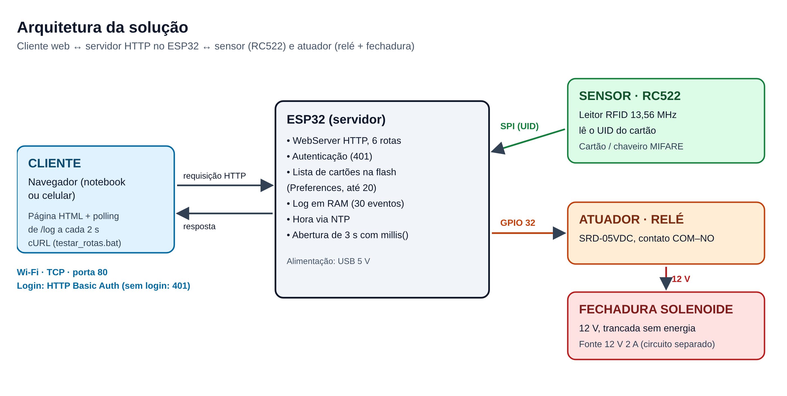
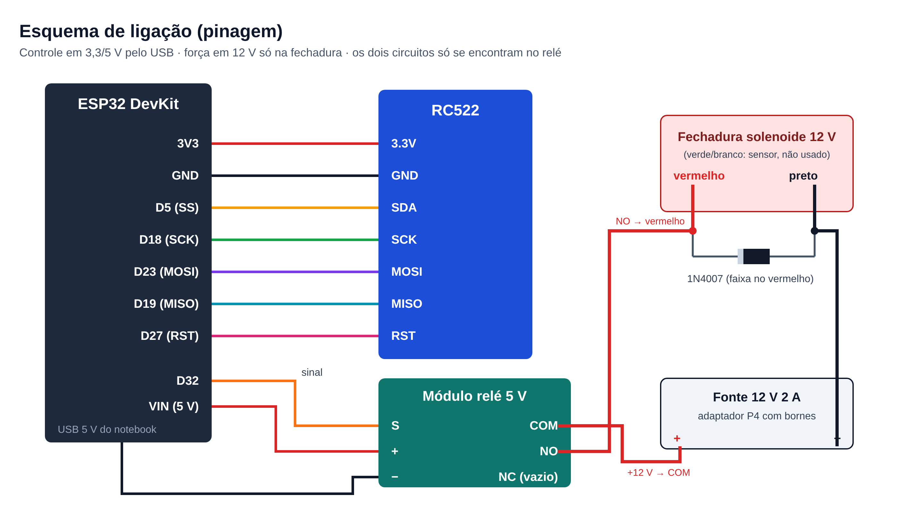

# Fechadura Eletrônica com RFID e ESP32

Fechadura eletrônica controlada por cartão RFID e administrada pela rede.

**O problema:** a chave física não registra quem entrou, pode ser copiada sem ninguém saber e, quando é perdida, obriga a trocar a fechadura.

**A solução:**
- Cada pessoa tem um cartão próprio.
- O ESP32 lê o cartão no RC522, confere se ele está autorizado e aciona a fechadura solenoide por um relé.
- O ESP32 também funciona como **servidor HTTP**. Pelo navegador, com login, dá para ver o log de acessos, cadastrar e apagar cartões e abrir a porta à distância.

Projeto do TDE da disciplina **Conectividade em Sistemas Ciberfísicos**: PUCPR, Engenharia de Software, Turma 2ºA, Prof. Fábio Bettio.

## Integrantes

| Nome | RA |
|---|---|
| Eduardo Reis Silva | 40126490 |
| Gabriel Cavalheiro de Oliveira | 40128957 |
| Gabriel Ramos Lucena Campos | 40129930 |
| Kauan Gomes Pains | 40120737 |
| Rodolfo Loures Bueno Belle | 40130664 |

## Arquitetura da solução



**Cartão autorizado:**
- a fechadura destrava por 3 segundos;
- o log registra `LIBERADO`.

**Cartão desconhecido:**
- a porta continua travada;
- o log registra `NEGADO`.

**Pela página web:**
- abrir a porta;
- cadastrar o último cartão lido;
- apagar cartões;
- ver o log, que se atualiza sozinho a cada 2 s (*polling*).

A lista de cartões fica na memória flash (`Preferences`) e não se perde ao desligar. Se o Wi-Fi cair com o sistema funcionando, o cartão continua abrindo a porta.

O fluxo completo, do cartão até a porta, está em [docs/fluxo.png](docs/fluxo.png).

## Hardware utilizado

| Peça | Função |
|---|---|
| ESP32 DevKit | Microcontrolador com Wi-Fi: roda o código e é o servidor web |
| Leitor RFID RC522 (13,56 MHz) | Sensor: lê o UID do cartão e envia ao ESP32 por SPI |
| Cartões e chaveiros MIFARE | Credencial de cada pessoa |
| Módulo relé 5 V (SRD-05VDC) | Atuador: o sinal do ESP32 liga o circuito de 12 V |
| Fechadura solenoide 12 V | Trava e destrava a porta. Fica trancada sem energia (*fail-secure*) |
| Fonte 12 V 2 A + adaptador P4 com bornes | Alimenta só a fechadura |
| Diodo 1N4007 | Proteção contra o pico de tensão da bobina |
| Jumpers e protoboard | Ligações |
| Maquete impressa em 3D | Parede, porta, base e suporte da fechadura ([docs/maquete_3d](docs/maquete_3d)) |

### Diagrama de conexões (pinagem)



| RC522 | ESP32 |
|---|---|
| SDA (SS) | GPIO 5 |
| SCK | GPIO 18 |
| MOSI | GPIO 23 |
| MISO | GPIO 19 |
| RST | GPIO 27 |
| 3.3V | 3V3 |
| GND | GND |

| Relé | Ligação |
|---|---|
| S (sinal) | GPIO 32 |
| + | VIN (5 V) |
| − | GND |
| COM | + da fonte 12 V |
| NO | fio vermelho da fechadura |
| NC | não usado |

O fio preto da fechadura vai no − da fonte 12 V. O diodo fica em paralelo com a bobina, com a faixa no lado do fio vermelho. Os 12 V nunca chegam ao ESP32: os dois circuitos só se encontram no relé.

## API HTTP

O servidor roda na porta 80 e todas as rotas exigem login (**HTTP Basic Auth**). Sem usuário e senha, ou com senha errada, o servidor responde **401** e não executa nada. Cada tentativa recusada fica registrada no log com o IP de origem.

| Método | Rota | Parâmetros | O que faz | Respostas |
|---|---|---|---|---|
| GET | `/` | — | Página de administração | 200, 401 |
| POST | `/abrir` | — | Destrava a porta por 3 s | 303, 401 |
| POST | `/cadastrar` | `uid`, `nome` | Cadastra um cartão | 303, 400 (campos vazios), 409 (já existe), 507 (lista cheia), 401 |
| POST | `/apagar` | `uid` | Remove um cartão | 303, 404 (não existe), 401 |
| GET | `/log` | — | Linhas do log de acessos (HTML) | 200, 401 |
| GET | `/ultimo` | — | UID do último cartão lido | 200, 401 |

As ações que mudam o estado só aceitam POST. Por isso, um GET em `/abrir` retorna 404 e não abre a porta.

**Exemplo com cURL:**
```
curl -u admin:1234 -X POST http://192.168.0.13/abrir
```

## Instalação e execução

1. Instale a **Arduino IDE** e o pacote de placas **esp32** (Espressif) no Gerenciador de Placas.
2. Instale a biblioteca **MFRC522** no Gerenciador de Bibliotecas.
3. Abra `src/esp32/fechadura_web/fechadura_web.ino` e troque `NOME_DA_REDE` e `SENHA_DA_REDE` pelos dados do seu Wi-Fi. A rede precisa ser **2,4 GHz**.
4. Selecione a placa **ESP32 Dev Module** e a porta COM, e carregue o código.
5. Abra o Monitor Serial a 115200 baud e aperte **EN**. O Monitor mostra o endereço, por exemplo `http://192.168.0.13`.
6. Num aparelho na mesma rede, abra o endereço no navegador. O login padrão é **admin / 1234**, definido em `WEB_USUARIO` e `WEB_SENHA`.
7. Ligue a fonte de 12 V. Ela pode ficar conectada, porque o relé só energiza a fechadura durante a abertura.

**Cliente:** a interface web é gerada e servida pelo próprio ESP32 na rota `/`. Em `src/client/` estão uma cópia legível dessa página (`index.html` e `app.js`) e o cliente de testes em linha de comando, `testar_rotas.bat`.

## Testes

O script `src/client/testar_rotas.bat` (Windows, cURL) testa todas as rotas, inclusive o login, e salva o resultado em `resultado_testes_curl.txt`.

- **Rotas:** as 15 requisições retornaram o código esperado: 401 sem login, 200, 303, 400, 404 e 409.
- **Carga:** 20 requisições seguidas, todas com 200, com tempo médio de **44 ms**.
- **Sem Wi-Fi:** com o roteador desligado, o cartão cadastrado continuou abrindo e o chaveiro continuou negado. Os eventos apareceram no log quando a rede voltou.
- **Flash:** a lista de cartões se manteve após reiniciar o ESP32.

## Screenshots

| Ciclo completo: negado, cadastrado, liberado e removido | Login exigido pela página |
|---|---|
|  | .png) |

| Log durante o teste sem Wi-Fi | Fechadura liberando o pino |
|---|---|
|  |  |

Todas as evidências estão em [docs/evidencias](docs/evidencias). A demonstração em vídeo foi feita ao vivo na apresentação.

## Estrutura do repositório

```
docs/
  arquitetura.png        diagrama da solução
  esquematico.png        esquema de ligação (pinagem)
  fluxo.png              fluxo do cartão até a porta
  Relatorio_TDE_Fechadura_Eletronica.pdf
  evidencias/            fotos e prints dos testes
  maquete_3d/            arquivos STL da maquete impressa em 3D
src/
  esp32/
    fechadura_web/       código final do ESP32 (servidor web + RFID + relé)
    testes/              códigos usados para testar cada peça
  client/
    index.html, app.js   interface web (cópia da página servida pelo ESP32)
    testar_rotas.bat     testes das rotas HTTP com cURL
    resultado_testes_curl.txt
README.md
.gitignore
```

## Limitações conhecidas

- O sistema autentica o **cartão**, não a pessoa: o UID de um cartão MIFARE Classic pode ser clonado. Uma versão futura usaria MIFARE DESFire ou cartão + PIN.
- A página tem login, mas sem HTTPS a senha trafega sem criptografia na rede, e ela é fixa no código.
- O log fica na RAM e se perde quando o ESP32 reinicia.
- O ESP32 precisa da rede disponível ao ligar, porque espera o Wi-Fi antes de iniciar o leitor.

## Contribuições

- Gabriel Cavalheiro de Oliveira: montagem e testes do hardware (ESP32, RC522, relé e fechadura), firmware do ESP32, testes das rotas HTTP, maquete impressa em 3D, documentação do repositório e relatório técnico; demonstração ao vivo na apresentação.

- Gabriel Ramos Lucena Campos: definição do problema e da proposta do projeto; abertura da apresentação.

- ⁠Rodolfo Loures Bueno Belle: estudo e apresentação do hardware (componentes, ligações e separação dos circuitos de controle e de 12 V).

- Kauan Gomes Pains: estudo e apresentação da parte de rede e do código (servidor HTTP, rotas, protocolos TCP/HTTP e login).
